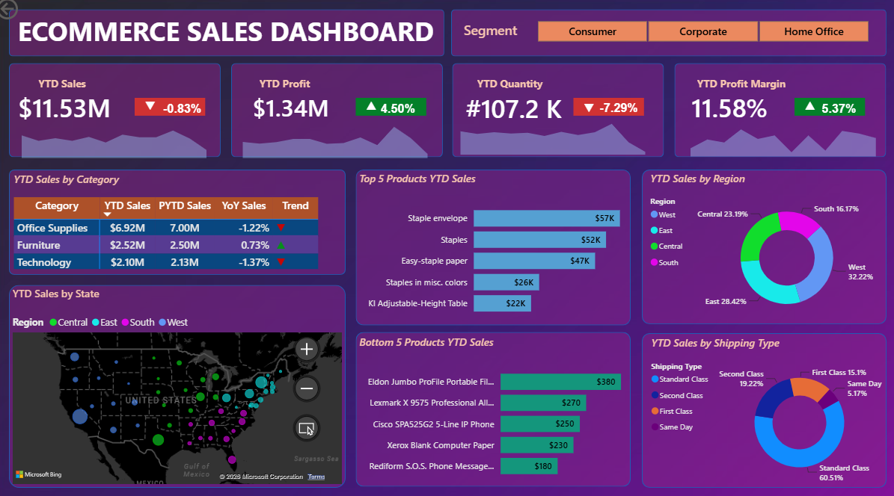

# E-commerce Sales Dashboard (Power BI)

A Power BI dashboard that tracks year-to-date (YTD) sales performance for a US-based e-commerce company. It compares 2022 against 2021 using DAX time-intelligence measures.

## Problem statement

A US based e-commerce sales company wants us to create a sales dashboard showing information of YTD sales and generate insights for the scenarios below:

- Create a KPI banner showing YTD Sales, YTD Profit, YTD Quantity sold and YTD Profit Margin.
- Find Year on Year growth for each KPI and show a YTD sparkline for each measure in the KPI to understand the monthly trend for each fact.
- Find YTD Sales, PYTD Sales and YoY Sales growth for different customer categories. Add a trend icon for each category.
- Find YTD Sales performance by each state.
- Top 5 and Bottom 5 products by sales.
- YTD Sales by region to know the best and worst performing region all over the country.
- YTD Sales by shipping type to get the best shipping type percentage.

## Tools

- Power BI (dashboard)
- DAX (YTD, PYTD and YoY measures)

## Dataset

`data/ecommerce_data.csv` has 113,270 rows and 21 columns. Every row is a unique order (one `order_id` each), placed between 4 Jan 2021 and 31 Dec 2022 by customers in 49 US states and districts. There are 3 product categories (Furniture, Office Supplies, Technology), 3 customer segments (Consumer, Corporate, Home Office), 4 regions and 4 shipping types. There are no null values and no duplicate rows.

`data/us_state_long_lat_codes.csv` is a supporting table of US state codes and coordinates.

Note: the CSV contains characters that are not UTF-8, so open it with Latin-1 / Windows-1252 encoding if you load it outside Power BI.

**Period definitions:** the data ends on 31 Dec 2022, so **YTD is Jan-Dec 2022** and **PYTD (previous year to date) is Jan-Dec 2021**.

## KPIs

| KPI | YTD (2022) | Change vs 2021 |
|---|---|---|
| YTD Sales | $11.53M | -0.83% |
| YTD Profit | $1.34M | +4.50% |
| YTD Quantity | 107.2K | -7.29% |
| YTD Profit Margin | 11.58% | +5.37% |

The profit margin change is a relative change (11.58% in 2022 vs 10.99% in 2021), not a change in percentage points.

## Key insights

- **Sales vs profit:** Sales fell 0.83% (from $11.63M to $11.53M) and quantity fell 7.29%, but profit grew 4.50% and the profit margin improved from 10.99% to 11.58%.
- **December drop:** Jan-Sep 2022 sales were 0.59% above the same period of 2021. December 2022 sales fell 24.7% year over year (about $244K lower), which more than explains the full-year decline of about $96K.
- **Category:** Office Supplies is the largest category at $6.92M (about 60% of sales) but fell 1.22%. Furniture ($2.52M) is the only category that grew (+0.73%). Technology ($2.10M) fell 1.37%.
- **Region:** West is the best performing region (32.22% of sales) and South is the weakest (16.17%). East has 28.42% and Central 23.19%.
- **State:** California leads with $2.34M (about 20% of sales), followed by New York ($1.29M) and Texas ($1.17M).
- **Shipping:** Standard Class makes up 60.51% of sales, followed by Second Class (19.22%), First Class (15.10%) and Same Day (5.17%).
- **Products:** The best seller is Staple envelope ($57K). The lowest seller is Rediform S.O.S. Phone Message Books ($180).
- **Segments:** Consumer brings $5.98M (about 52% of sales), Corporate $3.50M (about 30%) and Home Office $2.06M (about 18%). Profit grew for Consumer (+8.04%) and Home Office (+7.49%) but fell for Corporate (-2.95%).

## Dashboard



The segment slicer (Consumer, Corporate, Home Office) filters every visual on the page.

## Project structure

```
Ecommerce-Sales-Dashboard/
├── data/
│   ├── ecommerce_data.csv
│   └── us_state_long_lat_codes.csv
├── dax/measures.md
├── images/dashboard.png
├── powerbi/ecommerce_sales_dashboard.pbix
└── README.md
```

## How to open

1. Open `powerbi/ecommerce_sales_dashboard.pbix` in Power BI Desktop.
2. The DAX measures and the calendar table are listed in `dax/measures.md`.
